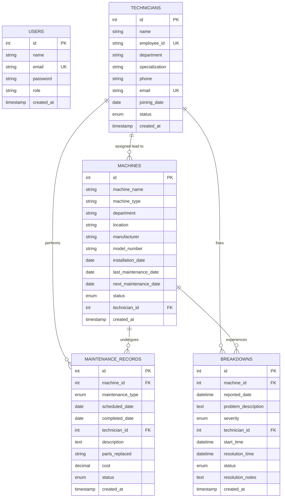

# Industrial Equipment Maintenance & Tracking System (EquipTrack Pro)

A complete, full-stack industrial equipment asset management and predictive/corrective maintenance tracking web application engineered for modern manufacturing plants, automated factories, and engineering facilities.

Developed as a college **Web Technology (CSE 3rd Year)** capstone project demonstrating robust 3-tier architecture, relational database integrity, role-based session authentication, and responsive user interfaces.

---

## 📌 Table of Contents

1. [Project Overview & Industrial Use Case](#1-project-overview--industrial-use-case)
2. [Key Features](#2-key-features)
3. [Technology Stack](#3-technology-stack)
4. [Project Folder Structure](#4-project-folder-structure)
5. [Prerequisites & System Requirements](#5-prerequisites--system-requirements)
6. [Step-by-Step Setup Guide (XAMPP + VS Code)](#6-step-by-step-setup-guide-xampp--vs-code)
   - [Step A: Copying Project to XAMPP htdocs](#step-a-copying-project-to-xampp-htdocs)
   - [Step B: Starting Apache & MySQL in XAMPP](#step-b-starting-apache--mysql-in-xampp)
   - [Step C: Importing MySQL Database](#step-c-importing-mysql-database)
   - [Step D: Verifying Database Configuration](#step-d-verifying-database-configuration)
   - [Step E: Accessing Application in Browser](#step-e-accessing-application-in-browser)
7. [Default Demo Login Credentials](#7-default-demo-login-credentials)
8. [Module-by-Module Technical Documentation](#8-module-by-module-technical-documentation)
   - [1. Authentication & Security](#module-1-authentication--security)
   - [2. Operations Dashboard & Dynamic KPI](#module-2-operations-dashboard--dynamic-kpis)
   - [3. Machines Inventory Management](#module-3-machines-inventory-management)
   - [4. Machine Detailed Profile & Service History](#module-4-machine-detailed-profile--service-history)
   - [5. Maintenance Work Orders](#module-5-maintenance-work-orders)
   - [6. Breakdown Incident Reporting & Downtime Tracking](#module-6-breakdown-incident-reporting--downtime-tracking)
   - [7. Technician Personnel Management](#module-7-technician-personnel-management)
   - [8. Dedicated Maintenance Schedule (Timeline & Overdue Alarms)](#module-8-dedicated-maintenance-schedule)
   - [9. Reliability Reports & Analytics](#module-9-reliability-reports--analytics)
   - [10. Administrator Profile & Credentials](#module-10-administrator-profile--credentials)
9. [Relational Database Schema & Architecture](#9-relational-database-schema--architecture)
10. [Troubleshooting & Common Questions](#10-troubleshooting--common-questions)
11. [College Viva & Presentation Guide](#11-college-viva--presentation-guide)

---

## 1. Project Overview & Industrial Use Case

In a modern manufacturing plant (e.g., automotive manufacturing, electronics assembly, FMCG packaging), unplanned machinery downtime is extremely expensive and disrupts production deadlines. 

The **Industrial Equipment Maintenance & Tracking System** provides plant superintendents, reliability engineers, and floor technicians with a single platform to:
- **Track Real-time Machine Status:** Monitor equipment operating conditions (`Working`, `Under Maintenance`, `Breakdown`, `Inactive`).
- **Schedule Preventive Maintenance:** Implement scheduled servicing routines (lubrication, sensor calibration, seal replacement) to prevent sudden failures.
- **Immediate Breakdown Incident Logging:** When machine failure occurs on the shop floor, operators can log a breakdown ticket which **automatically updates the machine's status to "Breakdown"** on the factory dashboard.
- **Calculate Real Equipment Downtime:** Automatically calculate exact hours and minutes lost between breakdown reporting and repair resolution.
- **Manage Specialist Technicians:** Assign work orders to specialized technicians (e.g., Hydraulic, Robotics, CNC, Electrical) and monitor personnel workloads.
- **Track Maintenance Expenditure:** Record parts replaced and dollar expenditures per work order to compute total machine lifecycle cost.

---

## 2. Key Features

- **Dynamic Statistics (Zero Hardcoding):** All dashboard metrics, KPI counts, status distributions, and charts are calculated on-the-fly using MySQL aggregation queries (`COUNT`, `SUM`, `AVG`).
- **Interactive Visual Charts:** Integrated with **Chart.js** for real-time visualization of machine availability, maintenance by category, department distribution, and breakdown severity.
- **Automated Workflow Logic:**
  - Filing a breakdown report automatically changes the target machine status to `Breakdown`.
  - Marking a maintenance order `In Progress` sets machine status to `Under Maintenance`.
  - Completing a maintenance order automatically updates the machine's `last_maintenance_date`, schedules the next preventive date (`+90 days`), and restores machine status back to `Working`.
  - Resolving a breakdown gives immediate prompt options to restore the machine to `Working`.
- **Overdue Priority Alerts:** Overdue maintenance tasks are highlighted with visual alert banners, red badges, and dedicated filtering.
- **Live Search & Filtering:** Filter equipment and logs by department, status, category, severity, and technician with instant results.
- **Enterprise Security Practices:** Password hashing with `password_hash()` (Bcrypt), SQL injection immunity via **PHP PDO prepared statements**, session hijacking mitigation, input sanitization, and CSRF prevention.
- **Responsive Industrial UI:** Engineered using a sleek Slate/Industrial palette, responsive sidebar navigation drawer for tablets and mobile devices, clean modal dialogs, and print-ready stylesheet for report exports.

---

## 3. Technology Stack

- **Frontend:**
  - **HTML5:** Semantic layout tags (`<aside>`, `<main>`, `<header>`, `<footer>`, `<dialog>`).
  - **CSS3:** Modern CSS variables, Flexbox, CSS Grid, custom card components, status pills, print stylesheets (`@media print`).
  - **JavaScript (Vanilla JS):** Mobile drawer menu toggle, asynchronous search filters, auto-dismissing flash alerts, delete confirmation modals.
  - **Chart.js (v4.4):** Interactive canvas data visualizations.
  - **Font Awesome 6:** Vector iconography for manufacturing tools and status alerts.
  - **Google Fonts (Inter):** High-readability technical typography.
- **Backend:**
  - **PHP (7.4 to 8.3+ compatible):** Modular architecture, session authentication, business workflow synchronization.
  - **PDO (PHP Data Objects):** Prepared statements, parameter binding, transactions (`beginTransaction`, `commit`, `rollBack`).
- **Database:**
  - **MySQL / MariaDB:** Relational schema with primary keys, foreign keys (`ON DELETE CASCADE`, `ON DELETE SET NULL`), indexes on status and dates.
- **Local Environment:**
  - **XAMPP (Apache HTTP Server + MariaDB/MySQL)** on Windows.
  - **VS Code** (Visual Studio Code) for code inspection and editing.

---

## 4. Project Folder Structure

```
Web_project/
│
├── .htaccess                       # Apache directory index & security rules
├── index.php                       # Application router (redirects to dashboard or login)
├── login.php                       # Secure user login with bcrypt authentication
├── logout.php                      # Session destroy & redirection handler
├── dashboard.php                   # Operations dashboard with live KPIs and Chart.js charts
├── database.sql                    # Complete database schema, foreign keys & demo seed data
├── README.md                       # Comprehensive technical and setup documentation
│
├── config/
│   └── database.php                # PDO connection singleton, base URL auto-detection
│
├── includes/
│   ├── auth.php                    # Session verification & authentication middleware
│   ├── functions.php               # Sanitization, flash messages, status badges, formatters
│   ├── header.php                  # Reusable HTML head, topbar, mobile menu & flash alerts
│   ├── sidebar.php                 # Unified sidebar with active link highlighting & live counter badges
│   └── footer.php                  # Application footer, delete confirmation modal, script imports
│
├── machines/                       # Machinery Management Module
│   ├── index.php                   # Equipment inventory table with search & department filters
│   ├── add.php                     # Add new equipment form with technician assignment
│   ├── edit.php                    # Edit machine specifications & status
│   ├── view.php                    # Complete machine profile with maintenance & breakdown history
│   └── delete.php                  # Safe deletion handler with confirmation
│
├── maintenance/                    # Maintenance Operations Module
│   ├── index.php                   # All maintenance work orders with category & machine filters
│   ├── add.php                     # Create work order with automated date & machine synchronization
│   ├── edit.php                    # Update status, record completed date, costs & parts replaced
│   ├── view.php                    # Detailed work order view with cost breakdown
│   └── delete.php                  # Delete maintenance record
│
├── breakdowns/                     # Breakdown Incident Module
│   ├── index.php                   # Breakdown incident list with severity indicators
│   ├── add.php                     # Report breakdown (auto-sets machine status to Breakdown)
│   ├── edit.php                    # Update ticket, log resolution notes & restore machine status
│   ├── view.php                    # Detailed breakdown ticket with exact downtime calculation
│   └── delete.php                  # Delete breakdown ticket
│
├── technicians/                    # Maintenance Personnel Module
│   ├── index.php                   # Technicians directory with workload & specialization
│   ├── add.php                     # Register technician with unique Employee ID & email validation
│   ├── edit.php                    # Edit technician profile & contact details
│   ├── view.php                    # Technician profile with assigned machines & job history
│   └── delete.php                  # Delete technician handler (sets foreign keys to NULL)
│
├── schedule/                       # Dedicated Maintenance Schedule Module
│   └── index.php                   # Categorized timeline tabs (All, Overdue, Today, Upcoming, Completed)
│
├── reports/                        # Analytics & Reporting Module
│   └── index.php                   # Machine availability, maintenance cost, and technician workload report
│
├── profile/                        # Operator Profile Module
│   └── index.php                   # Edit admin name/email and change password (bcrypt)
│
└── assets/
    ├── css/
    │   └── style.css               # Professional industrial stylesheet (Slate & Navy theme)
    ├── js/
    │   └── script.js               # Modal controllers, search filter & sidebar toggle
    └── images/                     # Asset graphics placeholder
```

---

## 5. Prerequisites & System Requirements

- **Operating System:** Windows 10 or Windows 11 (also runs on macOS / Linux).
- **Web Server:** XAMPP for Windows (with PHP 7.4, 8.0, 8.1, 8.2, or 8.3+).
- **Editor:** Visual Studio Code (VS Code).
- **Web Browser:** Google Chrome, Microsoft Edge, Mozilla Firefox, or Brave.

---

## 6. Step-by-Step Setup Guide (XAMPP + VS Code)

Follow these exact steps to run the project on your computer:

### Step A: Copying Project to XAMPP htdocs

XAMPP serves websites out of its `htdocs` directory (`C:\xampp\htdocs\`).

1. If you haven't installed XAMPP, download and install it from [https://www.apachefriends.org/](https://www.apachefriends.org/).
2. Locate the existing `Web_project` folder on your computer:
   `c:\Users\yogas\OneDrive\Desktop\Web_project`
3. Copy the entire `Web_project` folder into your XAMPP web root directory:
   ```
   C:\xampp\htdocs\Web_project
   ```
   *(Or you can create a Windows Directory Junction / Symlink if you prefer keeping it synced).*

### Step B: Starting Apache & MySQL in XAMPP

1. Open the **XAMPP Control Panel** (Run as Administrator if prompted).
2. Click the **Start** button next to **Apache**. The module background should turn **Green**.
3. Click the **Start** button next to **MySQL**. The module background should turn **Green**.

> **Note:** If Port 80 or 3306 has conflicts (e.g., Skype or IIS), see the [Troubleshooting](#10-troubleshooting--common-questions) section below.

### Step C: Importing MySQL Database

1. Open your web browser and navigate to **phpMyAdmin**:
   ```
   http://localhost/phpmyadmin/
   ```
2. Click on the **Databases** tab in the top navigation bar.
3. In the **Create database** input field:
   - Database name: `industrial_maintenance`
   - Collation: `utf8mb4_unicode_ci` (or default `utf8mb4_general_ci`)
   - Click the **Create** button.
4. On the left sidebar, click on your newly created database named **`industrial_maintenance`**.
5. Click on the **Import** tab in the top navigation bar.
6. Under **File to import**, click **Choose File** (or **Browse**).
7. Select the `database.sql` file located inside:
   ```
   C:\xampp\htdocs\Web_project\database.sql
   ```
8. Scroll to the bottom and click the **Import** (or **Go**) button.
9. You will see a green success message:
   `"Import has been successfully finished, queries executed."`
   The 5 tables (`users`, `technicians`, `machines`, `maintenance_records`, `breakdowns`) and all seed demo data are now ready!

### Step D: Verifying Database Configuration

Open `config/database.php` in VS Code. The default credentials are preconfigured for standard XAMPP installations:

```php
define('DB_HOST', 'localhost');
define('DB_PORT', '3306');
define('DB_NAME', 'industrial_maintenance');
define('DB_USER', 'root');
define('DB_PASS', '');          // Blank by default in XAMPP
```

If your local MySQL root user has a password, update `DB_PASS` accordingly.

### Step E: Accessing Application in Browser

Open your browser and navigate to:

```
http://localhost/Web_project/
```

You will automatically be greeted by the **EquipTrack Pro Login Screen**!

---

## 7. Default Demo Login Credentials

The database includes a pre-seeded Administrator account configured with secure Bcrypt password encryption:

| Field | Demo Credentials |
| :--- | :--- |
| **Email Address** | `admin@factory.com` |
| **Password** | `Admin@123` |
| **System Role** | Plant Administrator / Manager |

> **Pro-Tip for Demos:** On the login screen, there is a convenient **"Fill Demo"** button that auto-populates the login form in one click for quick professor demonstrations and viva presentations.

---

## 8. Module-by-Module Technical Documentation

### Module 1: Authentication & Security
- **File:** `login.php`, `logout.php`, `includes/auth.php`
- **Features:** Validates email and password using PHP's native `password_verify()`. On successful verification, session fixation protection is implemented via `session_regenerate_id(true)`.
- **Protection:** All inner modules include `require_login()`. Unauthorized visitors attempting to directly type internal URLs (e.g., `machines/index.php`) are intercepted and redirected to `login.php` with a flash error alert.
- **Logout:** Completely invalidates session cookies and session storage on the server.

### Module 2: Operations Dashboard & Dynamic KPIs
- **File:** `dashboard.php`
- **Features:**
  - 6 Real-time KPI Cards: Total Machines, Working Machines, Under Maintenance, Breakdown Machines, Total Technicians, and Upcoming Maintenance.
  - Interactive Visual Analytics powered by **Chart.js**:
    - **Machine Status Doughnut Chart:** Breakdown of working vs down machinery.
    - **Maintenance Work by Category Bar Chart:** Preventive vs Corrective vs Emergency distribution.
    - **Breakdown Severity Bar Chart:** Low, Medium, High, and Critical frequency.
  - Live activity tables showing upcoming maintenance, active breakdowns, and recent servicing history with direct one-click action shortcuts.

### Module 3: Machines Inventory Management
- **Files:** `machines/index.php`, `machines/add.php`, `machines/edit.php`, `machines/delete.php`
- **Fields:** Machine Name, Machine Type, Department (Production, Packaging, Assembly, Maintenance, Quality Control), Location, Manufacturer, Model/Serial Number, Installation Date, Last Maintenance Date, Next Maintenance Date, Operational Status, and Assigned Lead Technician.
- **Operations:**
  - Search by equipment name, model number, manufacturer, or shop floor bay.
  - Multi-criteria filtering by Status and Department.
  - Interactive Delete Confirmation Modal preventing accidental equipment deletion.

### Module 4: Machine Detailed Profile & Service History
- **File:** `machines/view.php`
- **Features:** Comprehensive 360-degree view of a single asset.
  - Displays hardware specs, floor bay location, and direct contact details of the assigned technician.
  - Computes **Total Lifecycle Maintenance Expenditure** for the asset.
  - Embedded **Maintenance History Table** showing past work orders, replaced parts, and costs.
  - Embedded **Breakdown Incident Table** displaying historical stoppage tickets and root-cause analysis.
  - Quick action shortcuts to immediately schedule maintenance or report a breakdown for that specific machine.

### Module 5: Maintenance Work Orders
- **Files:** `maintenance/index.php`, `maintenance/add.php`, `maintenance/edit.php`, `maintenance/view.php`, `maintenance/delete.php`
- **Categories:** Preventive, Corrective, Emergency.
- **Statuses:** Scheduled, In Progress, Completed, Cancelled.
- **Automation Logic:**
  - When marked **"In Progress"**, the related machine's status automatically switches to **"Under Maintenance"**.
  - When marked **"Completed"**, the system:
    1. Sets `completed_date` to today's date if blank.
    2. Updates the machine's `last_maintenance_date`.
    3. Calculates `next_maintenance_date` automatically (`+90 days` for preventive care).
    4. Automatically restores the machine's operational status back to **"Working"**.

### Module 6: Breakdown Incident Reporting & Downtime Tracking
- **Files:** `breakdowns/index.php`, `breakdowns/add.php`, `breakdowns/edit.php`, `breakdowns/view.php`, `breakdowns/delete.php`
- **Severities:** Low, Medium, High, Critical (pulsing visual alert for critical stoppages).
- **Statuses:** Reported, In Progress, Resolved.
- **Automation Logic:**
  - When a breakdown is logged, the affected machine's status in the database **automatically becomes "Breakdown"**.
  - Displays exact **Equipment Downtime Calculation** (e.g., `4 hours 15 mins`, or `Ongoing Stoppage`).
  - When a ticket is marked **"Resolved"**, the technician can enter root-cause resolution notes, record the fix timestamp, and choose to restore the machine status back to **"Working"**.

### Module 7: Technician Personnel Management
- **Files:** `technicians/index.php`, `technicians/add.php`, `technicians/edit.php`, `technicians/view.php`, `technicians/delete.php`
- **Fields:** Name, Employee ID (Unique, e.g., `TECH-101`), Department, Specialization, Phone, Email, Joining Date, Status (`Active`/`Inactive`).
- **Features:**
  - Workload metrics: Displays the number of assigned machines, active maintenance jobs, and handled breakdown tickets per technician.
  - Technician Profile Page shows all machines under the technician's care, along with complete logs of their servicing activity.
  - Safe deletion: Technicians can be removed without breaking foreign keys (associated machine records set `technician_id` to `NULL` cleanly).

### Module 8: Dedicated Maintenance Schedule
- **File:** `schedule/index.php`
- **Features:**
  - Visual category tabs with dynamic counters: **All Schedules**, **Overdue**, **Due Today**, **Upcoming**, and **Completed**.
  - **Overdue Priority Highlighting:** Overdue tasks are flagged with a prominent danger alert banner and distinct red table rows (`overdue-row`).
  - Due today tasks are highlighted in amber.
  - Direct shortcuts to edit or complete orders right from the schedule list.

### Module 9: Reliability Reports & Analytics
- **File:** `reports/index.php`
- **Features:**
  - **Equipment Availability Reports:** Working vs Down asset breakdown, factory departmental share percentage bars, and Department Bar Chart.
  - **Maintenance Financials:** Total maintenance dollars spent, average cost per job, and preventive vs corrective ratios.
  - **Breakdown Reliability Metrics:** Resolution rate percentage, critical stoppage count, and active incidents.
  - **Personnel Workload Report:** Full summary table of technician maintenance output.
  - **One-Click Print / PDF Export:** Formatted specifically with print stylesheets (`@media print`) so students can print clean report handouts for examiners.

### Module 10: Administrator Profile & Credentials
- **File:** `profile/index.php`
- **Features:**
  - View operator profile details and account registration date.
  - Form to update administrator Name and Email (with duplicate email validation).
  - Form to change account password (requires verifying current password with `password_verify()` before hashing the new password with Bcrypt).

---

## 9. Relational Database Schema & Architecture

The database is normalized up to **Third Normal Form (3NF)** with clear entity relationships:



### Foreign Key Integrity Constraints:
1. `MACHINES.technician_id` -> `TECHNICIANS.id` (`ON DELETE SET NULL`)
2. `MAINTENANCE_RECORDS.machine_id` -> `MACHINES.id` (`ON DELETE CASCADE`)
3. `MAINTENANCE_RECORDS.technician_id` -> `TECHNICIANS.id` (`ON DELETE SET NULL`)
4. `BREAKDOWNS.machine_id` -> `MACHINES.id` (`ON DELETE CASCADE`)
5. `BREAKDOWNS.technician_id` -> `TECHNICIANS.id` (`ON DELETE SET NULL`)

---

## 10. Troubleshooting & Common Questions

### Q1: "MySQL Connection Error" screen appears when I open the website.
- **Cause:** Either MySQL is not running in XAMPP, or the database `industrial_maintenance` has not been imported yet.
- **Solution:** 
  1. Open XAMPP Control Panel and ensure the **MySQL** module is running (showing Green).
  2. Open `http://localhost/phpmyadmin/` and make sure you followed [Step C](#step-c-importing-mysql-database) to create and import `database.sql`.

### Q2: Port 80 conflict in XAMPP (Apache won't start).
- **Cause:** Another program (e.g., Skype, VMware, or Windows IIS) is using Port 80.
- **Solution:** In XAMPP Control Panel, click **Config** on Apache -> **httpd.conf** -> search for `Listen 80` and change it to `Listen 8080`. Then access the project via `http://localhost:8080/Web_project/`.

### Q3: How do I change the database password if my local MySQL has a root password?
- **Solution:** Open `config/database.php` in VS Code and change line 18:
  ```php
  define('DB_PASS', 'your_mysql_password_here');
  ```

### Q4: I forgot my password or changed it. How do I reset the admin account?
- **Solution:** In `phpMyAdmin`, select `industrial_maintenance` -> `users` table, or re-run the `users` INSERT statement in `database.sql` to restore `admin@factory.com` with `Admin@123`.

---

## 11. College Viva & Presentation Guide

When presenting this project for your 3rd-year Web Technology review or viva, be prepared to answer these common questions:

### 1. What architecture does this application follow?
> *"The project follows a standard 3-Tier Web Architecture:*
> *1. Presentation Tier: Responsive HTML5, CSS3, JavaScript, Chart.js for visualization.*
> *2. Application / Logic Tier: PHP handles server-side business logic, status transitions, role authentication, and session security.*
> *3. Data Tier: MySQL stores persistent relational records with foreign key constraints, indexes, and transactions."*

### 2. How did you prevent SQL Injection?
> *"We utilized **PHP Data Objects (PDO)** with parameterized prepared statements across all SQL queries (e.g., `$stmt = $pdo->prepare('SELECT ... WHERE id = :id'); $stmt->execute([':id' => $id]);`). User inputs are treated strictly as data parameters rather than executable SQL commands, neutralizing SQL Injection vectors."*

### 3. How are passwords secured?
> *"Passwords are never stored in plaintext. They are encrypted using PHP's native `password_hash()` implementing the one-way **Bcrypt** cryptographic algorithm (`$2y$10$...`) with an automatically generated cryptographic salt. Authentication is verified using `password_verify()`."*

### 4. What is the business logic between Breakdowns and Machine Status?
> *"When an operator reports a breakdown, a database transaction automatically transitions the equipment's operational status to `Breakdown`. This reflects in real-time across the dashboard and inventory tables. When a technician resolves the incident and logs resolution notes, the system enables an automatic update to return the machine status back to `Working`."*

### 5. Why use PDO instead of MySQLi?
> *"PDO provides a clean, object-oriented API that supports multiple database drivers, uses robust Exception handling (`PDO::ERRMODE_EXCEPTION`), provides clean named parameters (`:machine_id`), and natively supports database transactions (`beginTransaction`, `commit`, `rollBack`)."*

---

## 👨‍💻 Developer Information

- **Project:** Industrial Equipment Maintenance & Tracking System (EquipTrack Pro)
- **Course:** B.E. / B.Tech Computer Science & Engineering (3rd Year)
- **Subject:** Web Technology Laboratory & Theory
- **Environment:** VS Code + XAMPP (Apache + MySQL + PHP)
- **Local URL:** `http://localhost/Web_project/`
